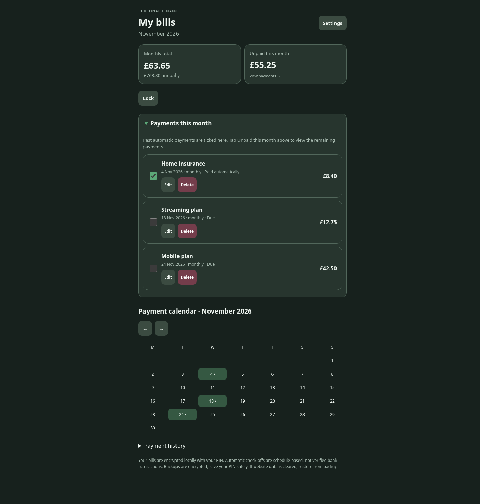
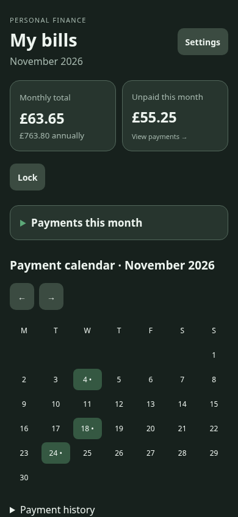
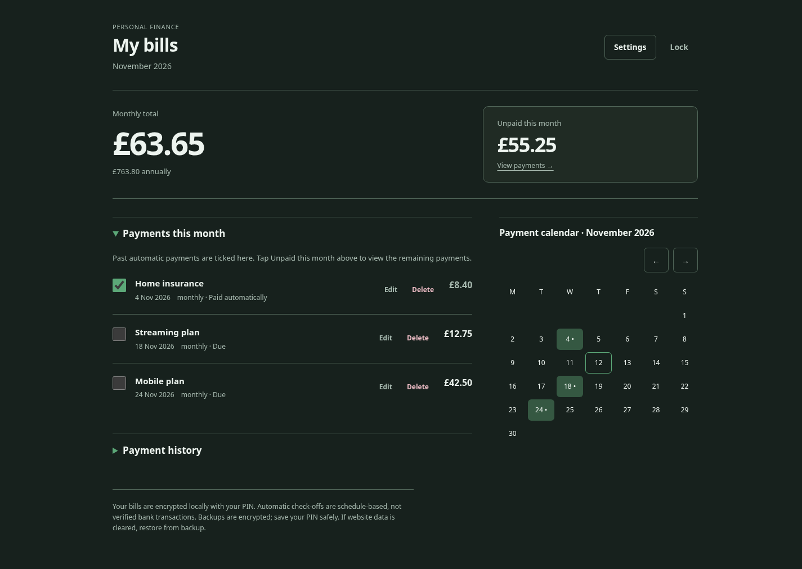
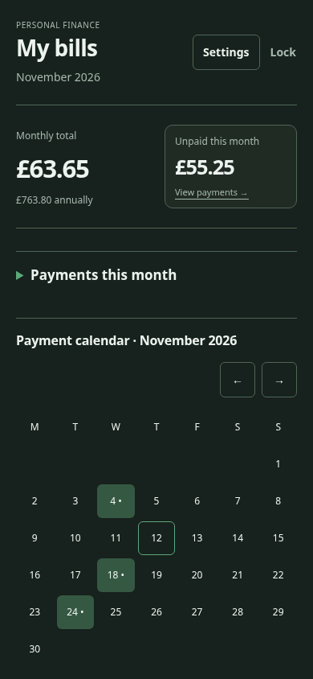

# Audit before redesign

Reviewed the current main branch in Chromium at 1440 × 1000, 390 × 844 and 320 × 740 before editing source. Screenshots linked below use synthetic bills in isolated local profiles, not the owner's records.

## Design read

Redesign-preserve of a personal finance PWA for everyday iPhone use. Calm green-and-grey visual language; compact financial ledger, native controls, restrained motion. DESIGN_VARIANCE 4 / MOTION_INTENSITY 2 / VISUAL_DENSITY 5. The existing screen reads approximately 2 / 1 / 5. Keep the project-owned CSS tokens and native platform components rather than introduce an enterprise framework or marketing-site pattern. Apply the named taste skill's audit/preservation rules with its Frontend UI Engineering workflow for these product surfaces.

## Existing system and content

- Stack: static HTML, CSS and JavaScript, no runtime npm dependencies; GitHub Pages and an offline service worker.
- Brand: Forest & slate default, with Sage, Emerald and Olive alternatives. Primary forest accent #5ca878, background #17211d, panel #27352e, text #edf4ef, muted #a8bab0. Existing icon and manifest remain recognizable.
- Type: device system font by default, optional self-hosted Manrope and Lora variable fonts. Preserve font choice and saved preferences.
- Shape: panels/items 16px, disclosures 14px, inputs/buttons 10px, dialogs 17px. Too many similar rounded containers flatten hierarchy.
- Architecture: PIN gate; single dashboard; monthly total and unpaid-dialog card; conditional missing dates; collapsible monthly payments; optional calendar; collapsible three-month history; Settings contains add/import/export/restore and theme/font/calendar preferences. Editor and unpaid list use native modal dialogs.
- Content: functional copy and privacy/backup notices all do work. Preserve labels, content, form order and field names. No new marketing copy or invented metrics.
- SEO/URL: one index route, title My Bills, manifest and existing icon. No route, title or metadata migration needed. No analytics or remote account service exists.

## Findings and changes proposed

1. Desktop is still a 650px phone column, with large unused side areas and the calendar pushed below the bill list. Use a wider bounded desktop composition with a bill/history column and a calendar column. Keep the existing reading order on mobile.
2. The monthly total and unpaid amount occupy equally weighted rounded cards. Give the overall monthly commitment a stronger typographic anchor and keep the unpaid total a clearly actionable secondary surface.
3. Every bill is another large rounded card with filled Edit/Delete buttons. Use flat rows, tabular currency, distinct date/status text and quieter action controls. Preserve all controls and their touch targets.
4. Lock sits in its own toolbar and creates a large empty band. Group it with Settings in the header, retaining both labels and actions.
5. Disclosure and calendar spacing are inconsistent. Use a small spacing scale and one documented radius system: flat ledger rows; 6px controls; 10px dialogs and grouped surfaces.
6. Settings can scroll its Done button off screen. Give dialog headings a stable surface and sticky placement, and tighten dead space while retaining all content.
7. Existing strengths to keep: four themes, real font options, labelled native inputs/dialogs, visible keyboard focus, 44px actions, no remote font requests, integer-pence totals, encrypted vault/history, local phone isolation, default-collapsed sections and offline updates.

## Preservation and verification plan

No framework conversion, new dependencies, route changes, logo changes, new bill seeds, data migration, encryption changes, or payment/history logic changes. The original dark-only choice is intentional from the product brief; retain it under both OS color-scheme preferences. Existing serif font choice remains a user preference, not the new default.

Check in Chromium at 320/390/768/1024/1440 widths, including populated and empty dashboard, expanded disclosures, Settings, unpaid dialog, editor and PIN gate. Verify keyboard controls, focus, no horizontal overflow, text/button contrast for all four palettes, reduced-motion behavior and saved preferences. Run the existing regression suite and Lighthouse if available. Capture real before/after screenshots and report limitations honestly.

The named taste workflow is aimed at marketing and portfolio layouts; this product dashboard is outside that layout scope. Its audit and preservation rules apply here, while its bundled Frontend UI Engineering workflow guides the app surfaces.

## Implemented direction

The redesign retains the existing forest background/accent and all three alternative palettes, user-selected fonts, app icon and functional content. The monthly total is the main visual anchor, with the unpaid total an actionable secondary surface. Payment entries use flat rows with tabular currency and quieter controls. The desktop calendar sits alongside bills/history; mobile retains the existing source reading order. Lock is grouped with Settings in the header. Dialog headings stay reachable while scrolling. Calendar arrows have descriptive accessible names, days have full date/payment labels, and today is identified visually and semantically. No payment, encryption or history calculation changes are included.

### Before and after

All images below show synthetic data in the real app. These records are not seeded into production.

| Desktop, with payments expanded | Mobile, default collapsed state |
| --- | --- |
| Before:  | Before:  |
| After:  | After:  |

## Browser verification and pre-flight

- Chromium: 320, 390, 768, 1024 and 1440 pixel widths. No horizontal page/dialog overflow. Desktop columns and mobile source order verified. Settings Done remains visible after scrolling to the bottom. The unpaid dialog, editor and PIN gate were visually inspected.
- All saved font choices tested on a 320px viewport; all four theme options checked for readable text/button contrast. Existing dark-only presentation is preserved under both light/dark OS preferences. Reduced motion removes the dialog animation.
- Full regression suite: 24 tests passed, covering encrypted storage, original bill/PIN compatibility, payment calculations, editing/import/backup, monthly history/rollover, themes/fonts/calendar preferences, responsive layout and offline/update behavior.
- Local Lighthouse 13.6, using the existing Chromium instance and provided/unthrottled timings: mobile and desktop each scored Performance 100, Accessibility 100 and Best Practices 100. SEO remained 90 due to the pre-existing absence of a meta description; no page title, route or metadata changes were introduced. These are local lab results, not production-network or physical iPhone measurements.
- Axe WCAG 2.1 AA checks: zero automated violations for the PIN gate, populated dashboard, unpaid dialog, editor and all four Settings palettes. Manual-review items were checked: the unpaid button's aria-controls resolves to the native dialog; arrow glyphs have descriptive accessible names and high-contrast foregrounds; the unpaid description has readable computed foreground/background and non-overlapping visible bounds. No claim that automation alone proves complete accessibility compliance.
- Design pre-flight: existing brand and content retained; consistent radius/spacing tokens; no new framework or runtime dependencies; no generated mockups, new icons, decorative photography, arbitrary hero/marketing components or remote font requests. Existing serif font remains an explicit user preference. Only motivated dialog state-transition motion is added, with reduced-motion support. Existing legal/privacy copy is untouched.
- Marketing-page-only checks (hero imagery, social proof, testimonial layouts, bento blocks and scroll choreography) do not apply to this product dashboard. The bundled Frontend UI Engineering guidance was used for these app surfaces.
- The service worker's content revision is regenerated. No storage schema, account model or data migration changes are made. Screenshots and browser tests contain no personal bill information.
